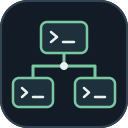
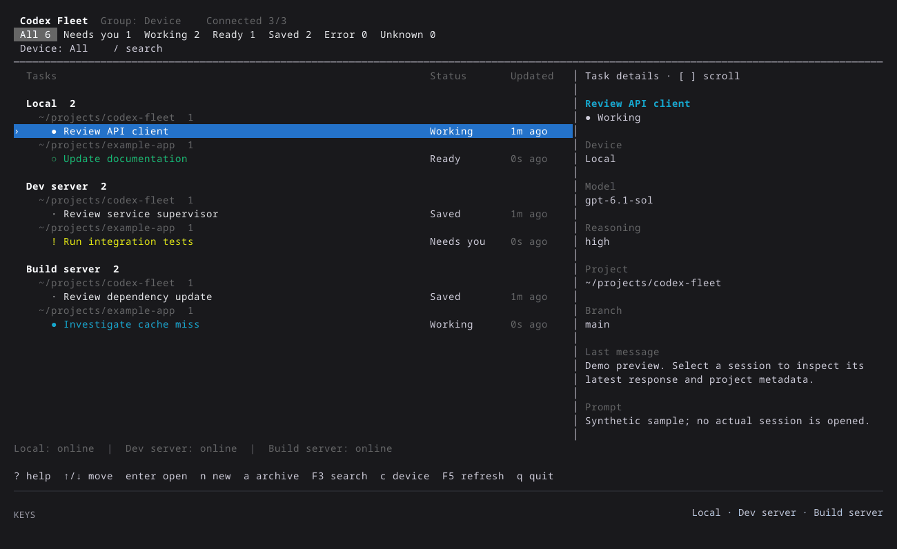
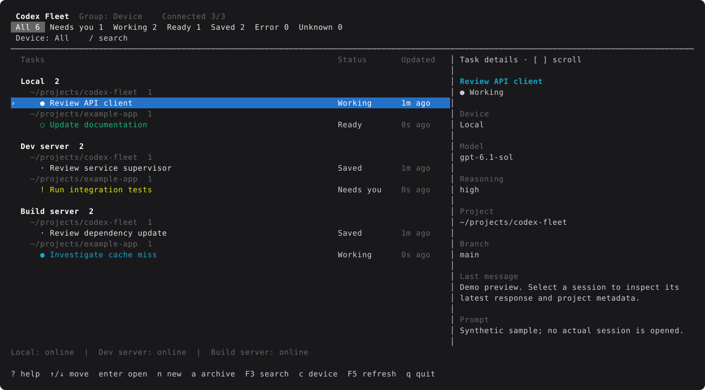

<div align="center">
  
  <h1>Codex Fleet</h1>
  <p><strong>Every host. Every session. One terminal.</strong></p>
  <p>The familiar Codex command center, extended across your development environments.</p>

  <a href="https://github.com/142spp/codex-fleet/actions/workflows/ci.yml"></a>
  <a href="Cargo.toml"></a>
  <a href="docs/validation.md"></a>
  <a href="LICENSE"></a>

  <p>
    <a href="#quick-start">Quick start</a> ·
    <a href="docs/usage.md">Usage</a> ·
    <a href="docs/configuration.md">Configuration</a> ·
    <a href="CONTRIBUTING.md">Contributing</a>
  </p>
</div>

<p align="center">
  
</p>
<p align="center"><sub>A continuous 24-second recording with synthetic sessions. Live key presses appear below the terminal.</sub></p>

Codex Fleet brings sessions from multiple local and SSH-connected hosts into
one terminal. See what needs attention, find a conversation across environments,
and resume it on the host where it already runs.

## Why Fleet?

[`codex agents`](https://learn.chatgpt.com/docs/developer-commands#codex-agents)
provides a command center for the shared server you are connected to, including
a remote server selected with `--remote`. Fleet takes inspiration from its
session list, keyboard controls and conversation preview.

With several independent servers, you end up switching connections to find a
session or check which environment needs attention. Identical project paths
and familiar task names can make it harder to tell where work is running.

Fleet extends that workflow into a single view across configured hosts:

| When work spans multiple hosts | What Fleet provides |
| --- | --- |
| Sessions are split between separate server views. | **One combined list**, grouped by host and working directory, or by project across hosts. |
| Finding blocked work means checking each environment. | **Shared status filters and search** across connected hosts, with host-specific filtering when needed. |
| Similar project paths and task names make ownership unclear. | **Host context alongside project context**, plus branch, model and recent conversation details. |
| Resuming requires finding the right environment and session. | **Enter to open the original thread** with its owning server socket and working directory; exit Codex to return to Fleet. |
| A connection drops while you are following several tasks. | **Cached rows marked offline**, automatic reconnection and a manual refresh shortcut. |

Familiar task actions are available from the same list: create, fork, rename,
stop, archive and delete sessions, or open a new Git worktree on the selected
host. Pin and hide preferences stay local to Fleet. Wide terminals show a
conversation sidebar; narrow terminals keep a compact list.

### Bring your own hosts

Use Fleet with a local development environment, remote development servers,
self-managed VMs or dedicated build and compute hosts. `Local`, `Dev server`
and `Build server` in the demo are example labels, not fixed device types.
Name each host for your own workflow and add or remove `[[hosts]]` entries in
the configuration. Each host needs a compatible Codex shared app-server;
the current implementation and validation target Linux.

Fleet reuses your existing SSH configuration and Codex authentication. It does
not move sessions or synchronize project files between hosts, and it does not
require a central service or an extra API key. The addition over the native
`agents` workflow is multi-server visibility and navigation, rather than remote
access itself.

<details>
<summary>Static preview</summary>



Actual TUI render with synthetic sessions. Your terminal's font and color theme
may differ.

</details>

## Quick start

**Requirements:** Linux, Rust 1.89+ and Cargo. Connecting real sessions also
requires OpenSSH and an authenticated Codex CLI with a running shared app-server
on each device.

### 1. Install and try the demo

```sh
git clone https://github.com/142spp/codex-fleet.git
cd codex-fleet
cargo install --path . --locked
codex-fleet --demo
```

The demo is self-contained: no credentials, servers or SSH connections required.
Cargo normally installs the binary to `~/.cargo/bin`; make sure it is on your
`PATH`.

### 2. Connect your hosts

```sh
mkdir -p ~/.config/codex-fleet
cp fleet.example.toml ~/.config/codex-fleet/fleet.toml
```

Edit the file to match your SSH aliases, then run:

```sh
codex-fleet --config ~/.config/codex-fleet/fleet.toml
```

For just the local device, run `codex-fleet` without a configuration flag.
See [configuration and troubleshooting](docs/configuration.md) for the full
example, executable paths and shared-server setup.

### 3. Make yourself at home

| Key | Action |
| --- | --- |
| `↑` / `↓` or `j` / `k` | Move between sessions |
| `Enter` | Open the selected session |
| `Tab` / `Shift-Tab` | Cycle status filters |
| `/` or `F3` | Search sessions |
| `g` | Change grouping |
| `a` | Archive the selected session |
| `?` | Show all shortcuts |

[Full keyboard reference →](docs/usage.md#keyboard-shortcuts)

## How it fits together

Fleet is a Rust TUI built with [Ratatui](https://ratatui.rs/) and Tokio. It
connects to each existing Codex app-server through a local Unix socket or an
OpenSSH proxy. Each server keeps ownership of its sessions and workspaces.

Browsing and previews are read-only. Task actions happen on explicit shortcuts;
opening a session hands the terminal to Codex and preserves its socket and
working directory. Fleet does not start or restart app-servers.

**Compatibility:** tested with Codex app-server 0.164.0, 0.165.0 and 0.166.0 on
Linux, including an ARM64 host. The upstream transport is experimental;
compatibility with every release is not guaranteed. See the
[validation record](docs/validation.md) for automated checks, live evidence and
current limits.

## Documentation

| Guide | What's inside |
| --- | --- |
| [Usage](docs/usage.md) | All shortcuts, statuses, session actions and CLI tools |
| [Configuration](docs/configuration.md) | Multiple devices, SSH, sockets and troubleshooting |
| [Design](docs/design.md) | Ownership, connections, rendering and protocol decisions |
| [Validation](docs/validation.md) | Test coverage, tested versions and known limits |
| [Contributing](CONTRIBUTING.md) | Development setup, checks and demo generation |

## Contributing

Bug reports and focused pull requests are welcome. Start with the
[contributor guide](CONTRIBUTING.md), or open a
[bug report](https://github.com/142spp/codex-fleet/issues/new?template=bug_report.md)
or [feature request](https://github.com/142spp/codex-fleet/issues/new?template=feature_request.md).

## License

[MIT](LICENSE). Codex Fleet is an independent project and is not affiliated with
or endorsed by OpenAI.
