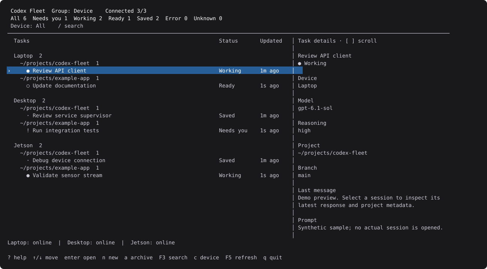
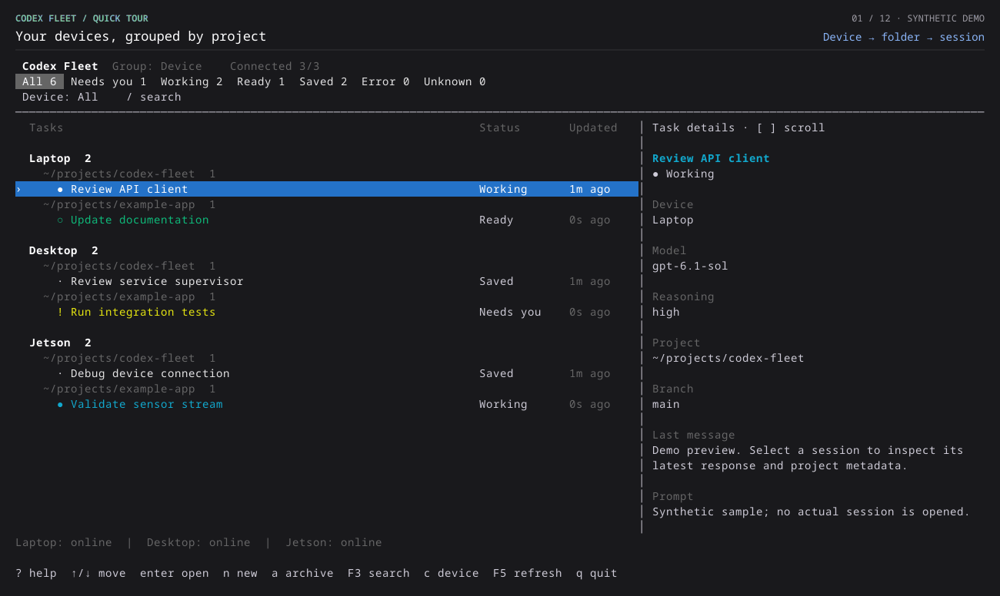

<div align="center">
  
  <h1>Codex Fleet</h1>
  <p><strong>Every device. Every session. One terminal.</strong></p>
  <p>A keyboard-first command center for Codex sessions across your computers.</p>

  <a href="https://github.com/142spp/codex-fleet/actions/workflows/ci.yml"></a>
  <a href="Cargo.toml"></a>
  <a href="docs/validation.md"></a>
  <a href="LICENSE"></a>

  <p>
    <a href="#quick-start">Quick start</a> ·
    <a href="docs/usage.md">Usage</a> ·
    <a href="docs/configuration.md">Configuration</a> ·
    <a href="CONTRIBUTING.md">Contributing</a>
  </p>
</div>

<p align="center">
  
</p>
<p align="center"><sub>Actual TUI render with synthetic sessions. Your terminal's font and color theme may differ.</sub></p>

Keep track of work on your laptop, desktop and embedded devices without cycling
through terminals. Inspired by `codex agents`, Fleet brings your existing
sessions into one view and opens the selected thread in its owning Codex CLI.

## Why Fleet?

| See the whole fleet | Pick up where you left off |
| --- | --- |
| **Device → folder → session.** A clear hierarchy, with status filters and search across all connected devices. | **Enter to resume.** Open the original session on its original device; exit Codex to return to Fleet. |
| **Room to read.** Wide terminals show status, timestamps and conversation details. Narrow terminals keep a compact list. | **Everyday task controls.** Create, fork, rename, stop and archive sessions, or start a fresh Git worktree. |
| **Keep your place.** Pin and hide sessions locally. Cached rows remain visible when a device goes offline. | **Use the setup you have.** Existing SSH aliases, Codex authentication and shared app-servers. No central service or extra API key. |

### See it in action



An 18-second tour captured from the running TUI with synthetic sessions.
The keys used in each step appear above the terminal. Prefer a still image?
[Open the static preview](docs/assets/demo.svg).

## Quick start

**Requirements:** Linux, Rust 1.89+ and Cargo. Connecting real sessions also
requires OpenSSH and an authenticated Codex CLI with a running shared app-server
on each device.

### 1. Install and try the demo

```sh
git clone https://github.com/142spp/codex-fleet.git
cd codex-fleet
cargo install --path . --locked
codex-fleet --demo
```

The demo is self-contained: no credentials, servers or SSH connections required.
Cargo normally installs the binary to `~/.cargo/bin`; make sure it is on your
`PATH`.

### 2. Connect your devices

```sh
mkdir -p ~/.config/codex-fleet
cp fleet.example.toml ~/.config/codex-fleet/fleet.toml
```

Edit the file to match your SSH aliases, then run:

```sh
codex-fleet --config ~/.config/codex-fleet/fleet.toml
```

For just the local device, run `codex-fleet` without a configuration flag.
See [configuration and troubleshooting](docs/configuration.md) for the full
example, executable paths and shared-server setup.

### 3. Make yourself at home

| Key | Action |
| --- | --- |
| `↑` / `↓` or `j` / `k` | Move between sessions |
| `Enter` | Open the selected session |
| `Tab` / `Shift-Tab` | Cycle status filters |
| `/` or `F3` | Search sessions |
| `g` | Change grouping |
| `a` | Archive the selected session |
| `?` | Show all shortcuts |

[Full keyboard reference →](docs/usage.md#keyboard-shortcuts)

## How it fits together

Fleet is a Rust TUI built with [Ratatui](https://ratatui.rs/) and Tokio. It
connects to each existing Codex app-server through a local Unix socket or an
OpenSSH proxy. Each server keeps ownership of its sessions and workspaces.

Browsing and previews are read-only. Task actions happen on explicit shortcuts;
opening a session hands the terminal to Codex and preserves its socket and
working directory. Fleet does not start or restart app-servers.

**Compatibility:** tested with Codex app-server 0.164.0, 0.165.0 and 0.166.0 on
Linux, including an ARM64 embedded host. The upstream transport is experimental;
compatibility with every release is not guaranteed. See the
[validation record](docs/validation.md) for automated checks, live evidence and
current limits.

## Documentation

| Guide | What's inside |
| --- | --- |
| [Usage](docs/usage.md) | All shortcuts, statuses, session actions and CLI tools |
| [Configuration](docs/configuration.md) | Multiple devices, SSH, sockets and troubleshooting |
| [Design](docs/design.md) | Ownership, connections, rendering and protocol decisions |
| [Validation](docs/validation.md) | Test coverage, tested versions and known limits |
| [Contributing](CONTRIBUTING.md) | Development setup, checks and demo generation |

## Contributing

Bug reports and focused pull requests are welcome. Start with the
[contributor guide](CONTRIBUTING.md), or open a
[bug report](https://github.com/142spp/codex-fleet/issues/new?template=bug_report.md)
or [feature request](https://github.com/142spp/codex-fleet/issues/new?template=feature_request.md).

## License

[MIT](LICENSE). Codex Fleet is an independent project and is not affiliated with
or endorsed by OpenAI.
